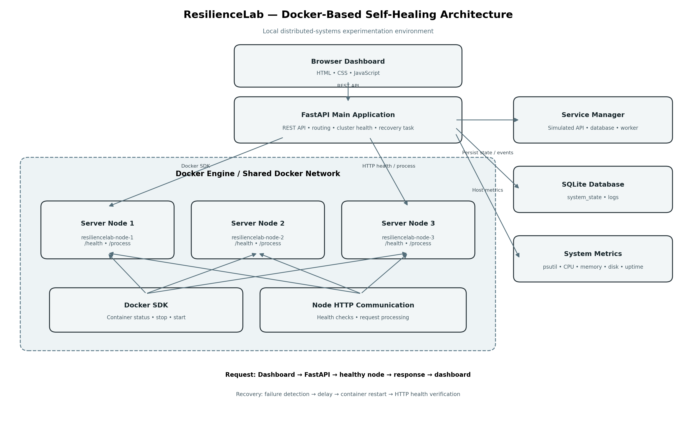
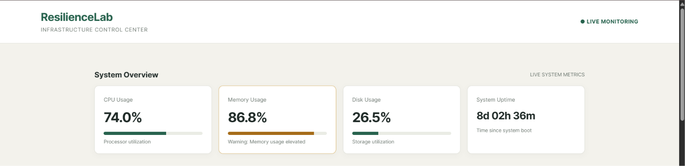
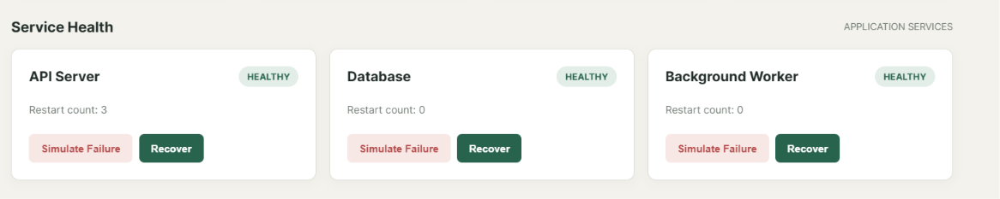
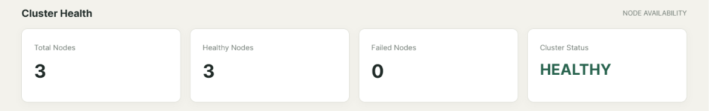
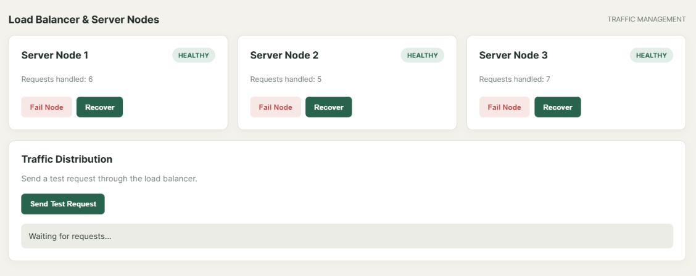
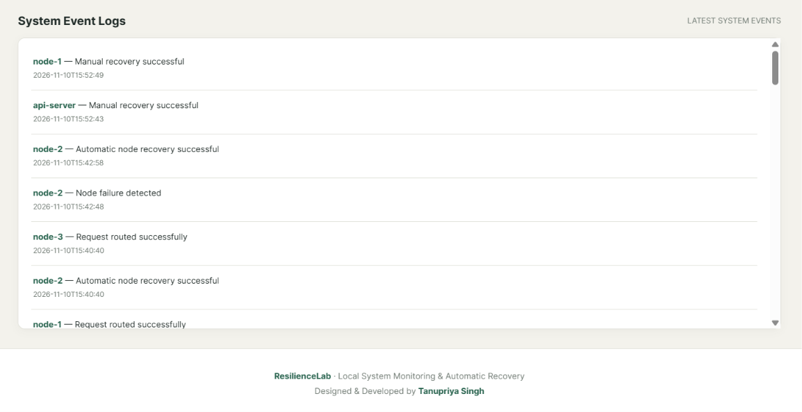

# ResilienceLab

### Self-Healing Distributed Systems Monitor

ResilienceLab is a Docker-based distributed systems monitoring and failure-recovery platform. It demonstrates how distributed services can detect failures, isolate unhealthy nodes, reroute requests, and automatically recover failed containers.

The platform combines a FastAPI backend, independent Docker-based server nodes, a monitoring dashboard, and persistent event logging to demonstrate core distributed systems reliability concepts.

## Overview

Modern applications depend on multiple services and server instances. When one component becomes unavailable, the system must detect the failure, maintain service availability, and recover the failed component.

ResilienceLab explores these challenges through a locally runnable distributed environment.

It uses actual Docker containers as server nodes and implements health checks, failure-aware request routing, round-robin load balancing, and automatic container recovery.

## Key Features

- **Docker-based server nodes:** Run independent server instances inside Docker containers.
- **Real-time health monitoring:** Check container status and HTTP health endpoints.
- **Failure injection:** Trigger failures by stopping actual Docker containers.
- **Automatic recovery:** Detect failed nodes and restart their containers after a configurable recovery interval.
- **Failure-aware routing:** Exclude unhealthy nodes from request distribution.
- **Round-robin load balancing:** Distribute requests across available server nodes.
- **Cluster health monitoring:** Track healthy and failed nodes and calculate overall cluster status.
- **Service failure simulation:** Simulate API, database, and background worker service failures.
- **System monitoring:** Display CPU, memory, disk usage, and uptime.
- **Persistent event logging:** Store events and system states using SQLite.
- **Live dashboard:** Monitor services, nodes, traffic distribution, and recovery events.

## Technology Stack

| Layer | Technologies |
|---|---|
| Backend | Python, FastAPI |
| Frontend | HTML, CSS, JavaScript |
| Containerization | Docker, Docker Compose |
| Server nodes | Python, FastAPI, Uvicorn |
| Database | SQLite |
| System metrics | psutil |
| Docker integration | Docker SDK for Python |
| API server | Uvicorn |

## System Architecture

ResilienceLab uses a central FastAPI application to monitor and coordinate independent Docker-based server nodes.

The application communicates with Docker through the Docker SDK and checks node health through HTTP endpoints.



### Request and Recovery Workflow

1. The dashboard sends requests to the FastAPI backend.
2. The backend checks the health of available Docker nodes.
3. The load balancer selects a healthy node using round-robin routing.
4. The selected node processes the request.
5. If a node fails, the router skips it and selects another healthy node.
6. The recovery process detects the failed container and attempts to restart it.
7. Health checks verify whether the recovered node is operational.
8. Events and system states are persisted in SQLite.

## Project Demo

Watch the ResilienceLab demonstration:

[](https://youtu.be/Pv6WM5nrrmQ)

▶ **[Watch the Full Demo on YouTube](https://youtu.be/Pv6WM5nrrmQ)**

The demonstration covers:

- Live system monitoring
- Service failure simulation
- Node health monitoring
- Round-robin load balancing
- Event logging
- Dashboard monitoring

*Video visibility: Unlisted.*

## Dashboard Preview

### System Overview



### Service Health



### Cluster Health



### Load Balancer and Server Nodes



### Event Logs



## Project Structure

```text
ResilienceLab/
├── app/
│   ├── __init__.py
│   ├── main.py
│   └── main_backup.py
├── assets/
│   ├── architecture/
│   ├── demo/
│   └── screenshots/
├── data/
│   └── resilience.db
├── docs/
│   ├── PROJECT_OVERVIEW.md
│   ├── SYSTEM_ARCHITECTURE.md
│   ├── TECHNICAL_DOCUMENTATION.md
│   ├── API_REFERENCE.md
│   ├── TESTING.md
│   ├── MARKET_RESEARCH.md
│   ├── REAL_WORLD_USE_CASES.md
│   ├── DEVELOPMENT_ROADMAP.md
│   └── DEPLOYMENT_GUIDE.md
├── nodes/
│   └── node_server.py
├── static/
│   └── index.html
├── .dockerignore
├── .gitignore
├── Dockerfile
├── Dockerfile.node
├── compose.yaml
├── requirements.txt
├── README.md
└── LICENSE
```

## Getting Started

### Prerequisites

- Docker Desktop
- Docker Engine with Docker Compose support
- Git

### 1. Clone the repository

```bash
git clone https://github.com/tanupriyasingh07/ResilienceLab.git
cd ResilienceLab
```

### 2. Build and start the main application

```bash
docker compose up -d --build
```

This builds the main application image and starts the FastAPI container.

### 3. Build the server node image

Open a terminal in the project directory:

```bash
docker build -f Dockerfile.node -t resiliencelab-node:v1 .
```

### 4. Create the Docker server nodes

The following commands create three independent server containers connected to the application's Docker Compose network.

```bash
docker run -d --name resiliencelab-node-1 --network resiliencelab_default -e NODE_ID=node-1 resiliencelab-node:v1

docker run -d --name resiliencelab-node-2 --network resiliencelab_default -e NODE_ID=node-2 resiliencelab-node:v1

docker run -d --name resiliencelab-node-3 --network resiliencelab_default -e NODE_ID=node-3 resiliencelab-node:v1
```

### 5. Verify the containers

```bash
docker ps
```

You should see the main application container and three server node containers running.

### 6. Access the application

- **Dashboard:** http://localhost:8000/
- **API documentation:** http://localhost:8000/docs
- **Application health:** http://localhost:8000/api/health
- **Node status:** http://localhost:8000/api/nodes
- **Cluster health:** http://localhost:8000/api/cluster-health

**Note:** The main application container mounts the Docker socket to manage node containers. This setup is intended for local development and experimentation. Do not expose the Docker socket or this configuration to an untrusted network.

## API Reference

| Endpoint | Method | Purpose |
|---|---|---|
| `/api/health` | GET | Check application status |
| `/api/services` | GET | View service status |
| `/api/services/{service_id}/fail` | POST | Simulate service failure |
| `/api/services/{service_id}/recover` | POST | Recover a service |
| `/api/nodes` | GET | View Docker node status |
| `/api/nodes/{node_id}/fail` | POST | Stop a Docker node |
| `/api/nodes/{node_id}/recover` | POST | Manually recover a node |
| `/api/route` | POST | Route a request to a healthy node |
| `/api/cluster-health` | GET | View cluster health |
| `/api/system` | GET | View system metrics |
| `/api/logs` | GET | Retrieve event logs |

Interactive API documentation is available at `/docs`.

## Testing and Validation

The following core workflows have been implemented and tested:

| Test | Result |
|---|---|
| Docker node health checks | Passed |
| Round-robin request distribution | Passed |
| Failure-aware request routing | Passed |
| Docker container failure detection | Passed |
| Automatic node recovery | Passed |
| Manual node recovery | Passed |
| Cluster health monitoring | Passed |
| SQLite state persistence | Passed |
| Restart counter validation | Passed |

The project has been tested locally with three independent Docker server nodes.

## Current Scope and Limitations

ResilienceLab is currently a local distributed systems experimentation platform, not a production-grade orchestration or high-availability solution.

- The main monitoring application runs as a single FastAPI instance.
- Server nodes run as independent Docker containers.
- Docker management currently depends on access to the Docker socket.
- Service failure simulation is separate from the actual Docker node failure mechanism.
- The current load balancer implements round-robin selection with health-aware routing.
- Recovery and health checks use configurable timing policies.
- The project has not yet been validated under large-scale production workloads.

## Future Development

Planned areas of development include:

- Prometheus-based metrics collection.
- Grafana observability dashboards.
- Latency, throughput, and recovery-time analysis.
- Advanced load-balancing strategies.
- Circuit breakers, retries, and timeout policies.
- Configurable fault injection and stress testing.
- PostgreSQL-based persistent storage.
- Distributed messaging with Kafka or RabbitMQ where appropriate.
- Advanced deployment and orchestration experiments.

These are future development goals, not features of the current release.

## Documentation

Detailed documentation is available in the [`docs/`](docs/) directory:

- [Project Overview](docs/PROJECT_OVERVIEW.md)
- [System Architecture](docs/SYSTEM_ARCHITECTURE.md)
- [Technical Documentation](docs/TECHNICAL_DOCUMENTATION.md)
- [API Reference](docs/API_REFERENCE.md)
- [Testing](docs/TESTING.md)
- [Market Research](docs/MARKET_RESEARCH.md)
- [Real-World Use Cases](docs/REAL_WORLD_USE_CASES.md)
- [Development Roadmap](docs/DEVELOPMENT_ROADMAP.md)
- [Deployment Guide](docs/DEPLOYMENT_GUIDE.md)

## Author

**Designed and developed by Tanupriya Singh**

## License

This project is licensed under the MIT License.

See the [LICENSE](LICENSE) file for details.
