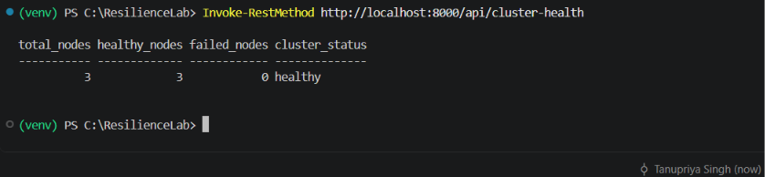
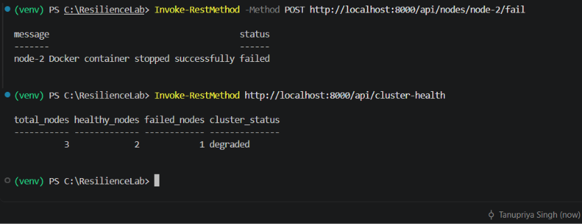
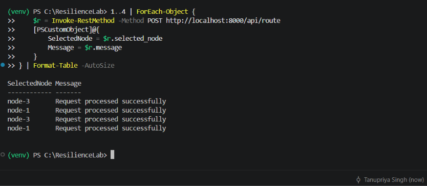
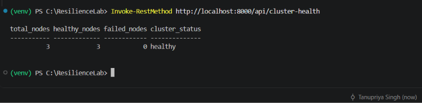
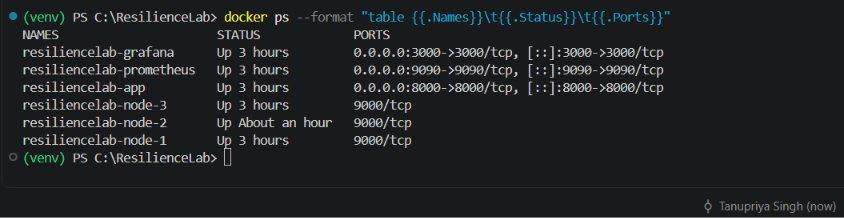
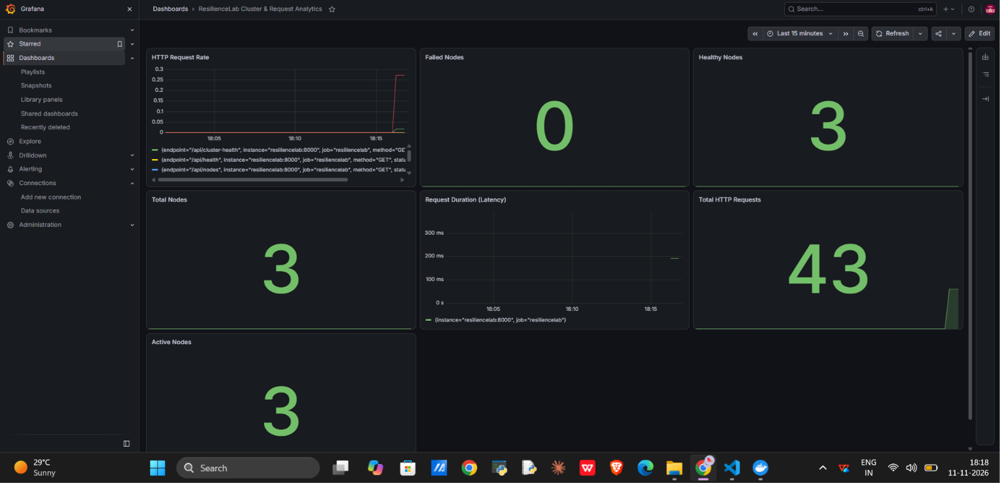
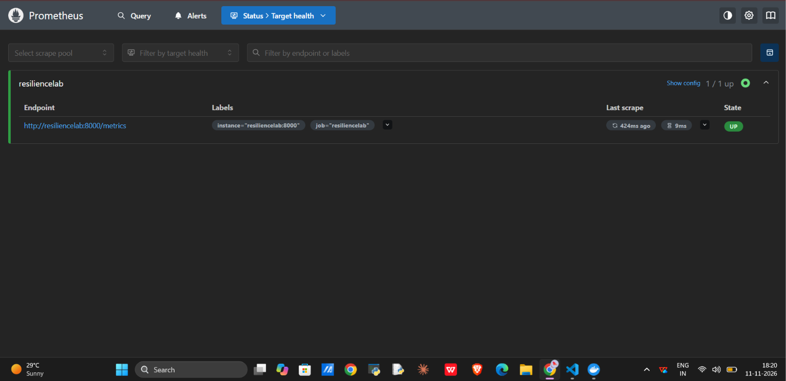

# ResilienceLab

### Self-Healing Distributed Systems Monitor

ResilienceLab is a Docker-based distributed systems monitoring and failure-recovery platform. It demonstrates how distributed services can detect failures, isolate unhealthy nodes, reroute requests, and automatically recover failed containers.

The platform combines a FastAPI backend, independent Docker-based server nodes, Prometheus metrics collection, Grafana observability dashboards, and persistent event logging.

## Overview

Modern applications depend on multiple services and server instances. When one component becomes unavailable, the system must detect the failure, maintain service availability, and recover the failed component.

ResilienceLab explores these challenges through a locally runnable distributed environment.

It uses actual Docker containers as server nodes and implements health checks, failure-aware request routing, round-robin load balancing, automatic container recovery, and monitoring.

## Key Features

- **Docker-based server nodes:** Run independent server instances inside Docker containers.
- **Real-time health monitoring:** Check container status and HTTP health endpoints.
- **Failure injection:** Trigger failures by stopping actual Docker containers.
- **Automatic recovery:** Detect failed nodes and restart their containers after a configurable recovery interval.
- **Failure-aware routing:** Exclude unhealthy nodes from request distribution.
- **Round-robin load balancing:** Distribute requests across available server nodes.
- **Cluster health monitoring:** Track healthy and failed nodes and calculate overall cluster status.
- **Service failure simulation:** Simulate API, database, and background worker service failures.
- **System monitoring:** Display CPU, memory, disk usage, and uptime.
- **Persistent event logging:** Store events and system states using SQLite.
- **Prometheus metrics:** Expose HTTP request counters, request duration histograms, and cluster node metrics.
- **Grafana dashboards:** Visualize request traffic, latency, and cluster health.
- **Containerized monitoring stack:** Run the application, Prometheus, and Grafana using Docker Compose.

## Technology Stack

| Layer | Technologies |
|---|---|
| Backend | Python, FastAPI |
| Frontend | HTML, CSS, JavaScript |
| Containerization | Docker, Docker Compose |
| Server nodes | Python, FastAPI, Uvicorn |
| Database | SQLite |
| System metrics | psutil |
| Docker integration | Docker SDK for Python |
| Application monitoring | Prometheus, prometheus-client |
| Visualization | Grafana |
| API server | Uvicorn |

## System Architecture

ResilienceLab uses a central FastAPI application to monitor and coordinate independent Docker-based server nodes.

The application communicates with Docker through the Docker SDK and checks node health through HTTP endpoints. Prometheus periodically scrapes application metrics, which Grafana visualizes through monitoring dashboards.


### Request and Recovery Workflow

1. The dashboard sends requests to the FastAPI backend.
2. The backend checks the health of available Docker nodes.
3. The load balancer selects a healthy node using round-robin routing.
4. The selected node processes the request.
5. If a node fails, the router skips it and selects another healthy node.
6. The recovery process detects the failed container and attempts to restart it.
7. Health checks verify whether the recovered node is operational.
8. Events and system states are persisted in SQLite.
9. Prometheus collects application metrics.
10. Grafana displays monitoring information through dashboards.

## Monitoring and Observability

ResilienceLab integrates Prometheus and Grafana for application and cluster monitoring.

### Prometheus

Prometheus scrapes metrics from the FastAPI application's `/metrics` endpoint every 5 seconds.

Implemented metrics include:

| Metric | Type | Description |
|---|---|---|
| `resiliencelab_http_requests_total` | Counter | Total HTTP requests |
| `resiliencelab_http_request_duration_seconds` | Histogram | HTTP request duration |
| `resiliencelab_active_nodes` | Gauge | Number of healthy Docker nodes |
| `resiliencelab_total_nodes` | Gauge | Total configured Docker nodes |

### Grafana Dashboard

Dashboard: **ResilienceLab Cluster & Request Analytics**

The combined dashboard contains seven panels:

1. HTTP Request Rate
2. Failed Nodes
3. Healthy Nodes
4. Total Nodes
5. Request Duration (Latency)
6. Total HTTP Requests
7. Active Nodes

### Monitoring URLs

- Prometheus: http://localhost:9090
- Prometheus Targets: http://localhost:9090/targets
- Grafana: http://localhost:3000
- Application Metrics: http://localhost:8000/metrics

**Local Grafana credentials:**

- Username: `admin`
- Password: `resiliencelab123`

These are development credentials. Change them before using the configuration in a shared or public environment.

## Project Demo

Watch the ResilienceLab demonstrations:

### 1. Original Project Walkthrough

[](https://youtu.be/Pv6WM5nrrmQ)

[Watch the Original Demo on YouTube](https://youtu.be/Pv6WM5nrrmQ)

### 2. Failure Detection & Automatic Recovery

[](https://youtu.be/iC2CTB5dyU4)

[Watch the Failure Recovery Demo on YouTube](https://youtu.be/iC2CTB5dyU4)

The demonstrations cover:

- Live system dashboard and monitoring
- Docker-based server nodes
- Service and node failure simulation
- Cluster health monitoring
- Failure-aware request routing
- Automatic node recovery
- Prometheus metrics collection
- Grafana monitoring dashboard
- Event logging

*Video visibility: Unlisted.*

## Dashboard Preview

### System Overview


### Service Health


### Cluster Health


### Load Balancer and Server Nodes


### Event Logs


## Failure Detection & Recovery Evidence

The following screenshots document the verified node failure and automatic recovery workflow.

### 1. Initial Cluster State

All three Docker nodes are healthy before failure injection.



### 2. Node Failure and Degraded Cluster

Node 2 is stopped through the application API. The cluster reports two healthy nodes and one failed node.



### 3. Failure-Aware Request Routing

Four successful requests are routed through the remaining healthy nodes, excluding the failed node.



### 4. Automatic Recovery

The failed node automatically recovers, and the cluster returns to three healthy nodes.



## Infrastructure & Monitoring Evidence

### Docker Container Infrastructure

The application, monitoring services, and three independent server nodes running as Docker containers.



### Grafana Monitoring Dashboard

The combined ResilienceLab monitoring dashboard with seven panels for request traffic, latency, and cluster health.



### Prometheus Target Health

Prometheus successfully scrapes the ResilienceLab application metrics endpoint.



## Project Structure

```text
ResilienceLab/
├── app/
│   ├── __init__.py
│   ├── main.py
│   └── main_backup.py
├── assets/
│   ├── architecture/
│   ├── demo/
│   └── screenshots/
├── data/
├── docs/
│   ├── PROJECT_OVERVIEW.md
│   ├── SYSTEM_ARCHITECTURE.md
│   ├── TECHNICAL_DOCUMENTATION.md
│   ├── API_REFERENCE.md
│   ├── TESTING.md
│   ├── MARKET_RESEARCH.md
│   ├── REAL_WORLD_USE_CASES.md
│   ├── DEVELOPMENT_ROADMAP.md
│   └── DEPLOYMENT_GUIDE.md
├── monitoring/
│   └── prometheus/
│       └── prometheus.yml
├── nodes/
│   └── node_server.py
├── static/
│   └── index.html
├── .dockerignore
├── .gitignore
├── Dockerfile
├── Dockerfile.node
├── compose.yaml
├── requirements.txt
├── README.md
└── LICENSE
```

## Getting Started

### Prerequisites

- Windows, Linux, or macOS
- Docker Desktop or Docker Engine
- Docker Compose
- Git

### 1. Clone the repository

```bash
git clone https://github.com/tanupriyasingh07/ResilienceLab.git
cd ResilienceLab
```

### 2. Build and start the application and monitoring stack

```bash
docker compose up -d --build
```

This starts:

- FastAPI application
- Prometheus
- Grafana

### 3. Build the server node image

```bash
docker build -f Dockerfile.node -t resiliencelab-node:v1 .
```

### 4. Create the Docker server nodes

The following commands create three independent server containers connected to the application's Docker Compose network.

```bash
docker run -d --name resiliencelab-node-1 --network resiliencelab_default -e NODE_ID=node-1 resiliencelab-node:v1

docker run -d --name resiliencelab-node-2 --network resiliencelab_default -e NODE_ID=node-2 resiliencelab-node:v1

docker run -d --name resiliencelab-node-3 --network resiliencelab_default -e NODE_ID=node-3 resiliencelab-node:v1
```

### 5. Verify containers

```bash
docker ps
```

You should see the application, monitoring services, and three server node containers running.

### 6. Configure Grafana

1. Open http://localhost:3000.
2. Log in using the local development credentials.
3. Add a Prometheus data source.
4. Set the Prometheus URL to `http://prometheus:9090`.
5. Save and test the data source.
6. Open the ResilienceLab monitoring dashboard.

### 7. Access the application

| Service | URL |
|---|---|
| Application Dashboard | http://localhost:8000/ |
| API Documentation | http://localhost:8000/docs |
| Application Health | http://localhost:8000/api/health |
| Node Status | http://localhost:8000/api/nodes |
| Cluster Health | http://localhost:8000/api/cluster-health |
| Prometheus Metrics | http://localhost:8000/metrics |
| Prometheus | http://localhost:9090 |
| Grafana | http://localhost:3000 |

**Security note:** The main application mounts the Docker socket to manage node containers. Docker socket access can provide extensive host-level control. This setup is intended for local development and experimentation. Do not expose it to an untrusted network.

## API Reference

| Endpoint | Method | Purpose |
|---|---|---|
| `/api/health` | GET | Check application status |
| `/api/services` | GET | View service status |
| `/api/services/{service_id}/fail` | POST | Simulate service failure |
| `/api/services/{service_id}/recover` | POST | Recover a service |
| `/api/nodes` | GET | View Docker node status |
| `/api/nodes/{node_id}/fail` | POST | Stop a Docker node |
| `/api/nodes/{node_id}/recover` | POST | Manually recover a node |
| `/api/route` | POST | Route a request to a healthy node |
| `/api/cluster-health` | GET | View cluster health |
| `/api/system` | GET | View system metrics |
| `/api/logs` | GET | Retrieve event logs |
| `/metrics` | GET | Expose Prometheus metrics |

Interactive API documentation is available at `/docs`.

## Testing and Validation

The following workflows have been tested locally with three independent Docker server nodes.

| Test | Result |
|---|---|
| Docker container startup | Passed |
| Application health check | Passed |
| Three-node cluster health | Passed |
| Docker node failure simulation | Passed |
| Cluster failure detection | Passed |
| Round-robin request distribution | Passed |
| Failure-aware request routing | Passed |
| Automatic node recovery | Passed |
| Node restart status verification | Passed |
| SQLite state persistence | Previously tested |
| Prometheus target scraping | Passed |
| HTTP request metrics collection | Passed |
| Request duration metrics | Passed |
| Grafana dashboard integration | Passed |
| Seven-panel monitoring dashboard | Passed |

### Observed Failure-Recovery Test

During local validation:

- Three nodes initially reported healthy.
- Node 2 was stopped through the application API.
- Cluster health changed to 2 healthy nodes and 1 failed node.
- Four subsequent requests were routed alternately between Node 1 and Node 3.
- Node 2 automatically recovered after the configured recovery interval.
- All three nodes subsequently reported healthy.

## Current Scope and Limitations

ResilienceLab is currently a local distributed systems experimentation platform, not a production-grade orchestration or high-availability solution.

- The main monitoring application runs as a single FastAPI instance.
- Server nodes run as independent Docker containers.
- Docker management depends on access to the Docker socket.
- Service failure simulation is separate from the actual Docker node failure mechanism.
- The current load balancer implements round-robin selection with health-aware routing.
- Cluster node metrics are refreshed when the cluster-health endpoint is queried.
- Recovery and health checks use configurable timing policies.
- The project has not been validated under large-scale production workloads.

## Future Development

Potential areas for future development include:

- Continuous background refresh of cluster metrics.
- Advanced load-balancing strategies.
- Circuit breakers, retries, and timeout policies.
- Configurable fault injection and stress testing.
- Recovery-time and throughput benchmarking.
- PostgreSQL-based persistent storage.
- Distributed messaging with Kafka or RabbitMQ where appropriate.
- Advanced deployment and orchestration experiments.

These are future development goals, not features of the current release.

## Documentation

Detailed documentation is available in the [`docs/`](docs/) directory:

- [Project Overview](docs/PROJECT_OVERVIEW.md)
- [System Architecture](docs/SYSTEM_ARCHITECTURE.md)
- [Technical Documentation](docs/TECHNICAL_DOCUMENTATION.md)
- [API Reference](docs/API_REFERENCE.md)
- [Testing](docs/TESTING.md)
- [Market Research](docs/MARKET_RESEARCH.md)
- [Real-World Use Cases](docs/REAL_WORLD_USE_CASES.md)
- [Development Roadmap](docs/DEVELOPMENT_ROADMAP.md)
- [Deployment Guide](docs/DEPLOYMENT_GUIDE.md)

## Author

**Designed and developed by Tanupriya Singh**

## License

This project is licensed under the MIT License.

See the [LICENSE](LICENSE) file for details.