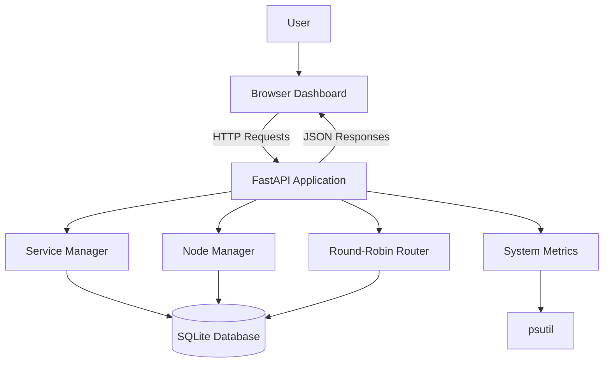

# System Architecture

## 1. Architecture Overview

ResilienceLab currently follows a simple three-layer architecture:

1. **Presentation Layer:** Browser-based dashboard.
2. **Application Layer:** FastAPI backend containing simulation logic and REST endpoints.
3. **Data Layer:** SQLite database for event logs and persisted system state.

The browser communicates with the backend through HTTP requests. The backend processes these requests, updates the simulation state, and returns JSON responses.

## 2. High-Level Architecture

## 3. Component Responsibilities

### 3.1 Browser Dashboard

Location: `static/index.html`

Responsibilities:

- Display system resource metrics.
- Show service and node health.
- Display overall cluster health.
- Trigger failure and recovery operations.
- Display request distribution.
- Show recent system events.
- Refresh displayed information periodically.

The dashboard uses HTML, CSS, and JavaScript.

### 3.2 FastAPI Application

Location: `app/main.py`

Responsibilities:

- Expose REST API endpoints.
- Maintain simulated service and node states.
- Process failure and recovery requests.
- Execute automatic recovery checks.
- Route test requests to healthy nodes.
- Calculate cluster health.
- Collect local system metrics.
- Retrieve event logs.

### 3.3 Service Manager

The service manager maintains the state of the simulated services:

- `api-server`
- `database`
- `worker`

It handles manual failure, recovery, failure timestamps, and automatic recovery checks.

### 3.4 Node Manager

The node manager maintains three simulated nodes:

- `node-1`
- `node-2`
- `node-3`

It tracks node health, failure timestamps, restart counts, and request counts.

### 3.5 Load Balancer

The current implementation uses round-robin scheduling.

It selects the next healthy node in sequence. Failed nodes are excluded from the selection process.

If no healthy node is available, the routing endpoint returns an HTTP 503 response.

### 3.6 Monitoring Module

The monitoring functionality uses `psutil` to collect information from the local machine:

- CPU utilization
- Memory utilization
- Disk utilization
- System uptime

These metrics describe the machine running ResilienceLab, not a collection of independent servers.

### 3.7 SQLite Storage

Database location: `data/resilience.db`

SQLite is used to persist:

- System event logs.
- Relevant service and node state.

The application loads saved state when it starts and records important state changes.

## 4. Data Flow

### 4.1 Dashboard Refresh

1. The browser sends requests to the relevant API endpoints.
2. FastAPI retrieves the latest simulation state.
3. The backend returns JSON responses.
4. JavaScript updates the dashboard.
5. The refresh cycle repeats approximately every three seconds.

### 4.2 Failure Simulation

1. A user selects a service or node failure action.
2. The dashboard sends a POST request.
3. The backend marks the selected component as failed.
4. The failure timestamp is recorded.
5. The state change is persisted and logged.
6. The dashboard displays the updated status.

### 4.3 Automatic Recovery

1. A background checker examines failed components.
2. It compares the current time with the recorded failure time.
3. Once the configured recovery interval has elapsed, the component is restored.
4. The restart counter is updated where applicable.
5. The recovery event is logged.
6. The dashboard displays the recovered state.

### 4.4 Request Routing

1. A client or dashboard action calls the routing endpoint.
2. The backend identifies healthy nodes.
3. The round-robin pointer selects the next eligible node.
4. The selected node's request counter is incremented.
5. The routing result is returned.

## 5. State and Persistence

The simulation maintains service and node state in application memory.

SQLite provides persistence for relevant state and event records. Failure timestamps are important because they allow the application to determine whether an automatic recovery interval has elapsed.

The current design is suitable for a single-process simulation. It does not provide distributed state coordination between multiple backend instances.

## 6. Architecture Limitations

The current architecture has the following boundaries:

- All simulated services and nodes run within one application process.
- There is no independent service-to-service network communication.
- SQLite is used for local persistence.
- There is no distributed consensus or leader election.
- The load balancer is an application-level simulation.
- Recovery changes simulated state rather than restarting real infrastructure.
- The dashboard communicates with the backend through HTTP polling rather than WebSockets.

## 7. Planned Architecture Evolution

Future development may introduce:

- Independent services running in Docker containers.
- Container health checks.
- Real inter-service communication.
- Redis or another shared state store.
- PostgreSQL for larger deployments.
- Prometheus metrics integration.
- Grafana dashboards.
- Configurable recovery policies.
- Remote deployment and multi-user access.

These changes will require additional architectural design and testing before being considered implemented.